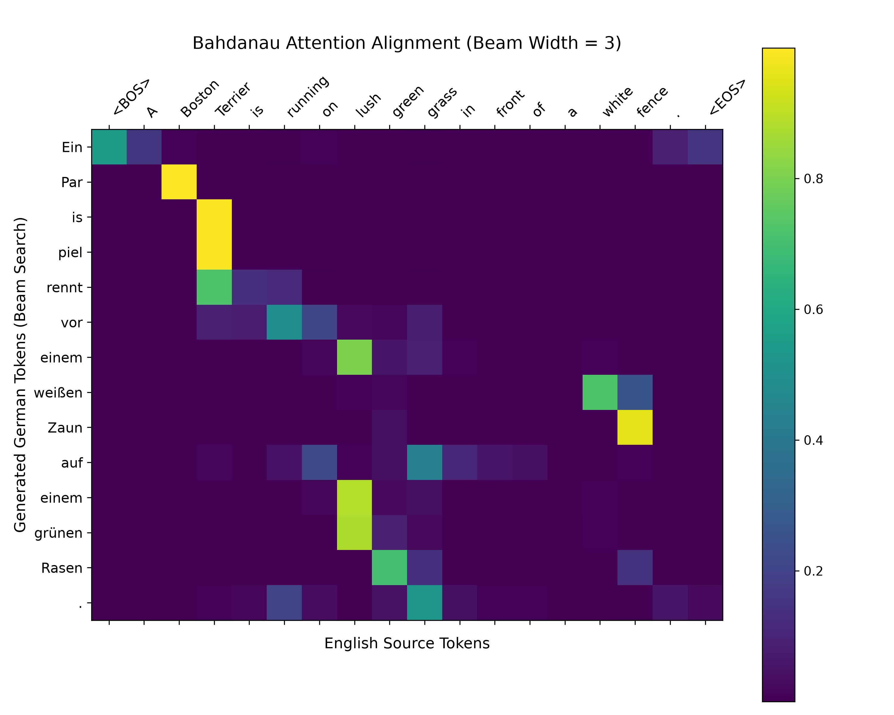

# English-to-German Neural Machine Translation (From Scratch)

A PyTorch implementation of an **English-to-German Neural Machine Translation (NMT)** system built from scratch on the **Multi30k** dataset. This repository documents an iterative engineering progression—scaling from a baseline single-layer GRU (**13.18 BLEU**) up to a **2-Layer Bidirectional LSTM with Bahdanau (Additive) Attention** achieving **31.50 BLEU** on the unseen test set.

---

## Key Highlights & Progression

* **Custom BPE Subword Tokenization:** Trained a shared 12,000-token Byte-Pair Encoding (BPE) vocabulary from scratch using Hugging Face `tokenizers`, eliminating out-of-vocabulary (`<UNK>`) failures on German compound words.
* **Iterative Architecture Scaling:** Benchmarked 6 controlled architectural variations (detailed in [`experiments_log.md`](experiments_log.md)), isolating the impact of model capacity, dropout, label smoothing, weight tying, bidirectionality, and attention.
* **Beam Search & Length Normalization:** Implemented autoregressive beam search decoding (`beam_width=3`, `length_penalty=0.7`) alongside regex detokenization, evaluated via `sacrebleu`.
* **Attention Interpretability:** Visualized word-level alignment and German grammatical reordering using attention heatmaps extracted directly from the decoder.

---

## Experimental Results Summary

Evaluated on the Multi30k test split (1,000 unseen sentence pairs) using corpus **SacreBLEU**:

| Experiment | Architecture | Key Settings & Regularization | Best Val Acc | Test BLEU |
| :--- | :--- | :--- | :---: | :---: |
| **Exp 1** | 1-Layer GRU | `hidden=256`, no dropout + detokenizer | 45.76% | **13.18** |
| **Exp 2** | 2-Layer GRU | `hidden=512`, `dropout=0.3` | 49.36% | **18.11** |
| **Exp 3** | 2-Layer GRU | Added label smoothing, weight decay, weight tying | 56.57% | **0.01** *(loop bug)* |
| **Exp 3a** | 2-Layer GRU | Removed weight tying, `dropout=0.4`, label smoothing (`0.1`) | 56.50% | **24.19** |
| **Exp 4** | 2-Layer BiLSTM | `hidden=512`, `dropout=0.4`, `tanh` state bridges | 53.28% | **21.41** |
| **Exp 5** | 2-Layer BiLSTM + Attention | **Bahdanau Attention**, linear bridges, `dropout=0.4` | **62.83%** | **31.50** |

> Full training logs, loss curves analysis, and failure diagnostics are available in **[`experiments_log.md`](experiments_log.md)**.

---

## Sample Translations (Exp 5: BiLSTM + Bahdanau Attention)

| Source (English) | Reference (German) | Model Prediction (Beam Search) |
| :--- | :--- | :--- |
| *A man in an orange hat starring at something.* | *Ein Mann mit einem orangefarbenen Hut, der etwas anstarrt.* | *Ein Mann mit einem orangefarbenen Hut betrachtet etwas.* |
| *A Boston Terrier is running on lush green grass in front of a white fence.* | *Ein Boston Terrier läuft über saftig-grünes Gras vor einem weißen Zaun.* | *Ein Parispiel rennt vor einem weißen Zaun auf einem grünen Rasen.* |
| *A girl in karate uniform breaking a stick with a front kick.* | *Ein Mädchen in einem Karateanzug bricht ein Brett mit einem Tritt.* | *Ein Mädchen in Karateanzügen uniform dabei einen Stock mit einem Vortritt.* |

---

## Attention Alignment Visualization

Plotting the attention weights (`attn_weights`) across decoding steps shows how the model aligns English source tokens with German target words—including grammatical phrase reordering (*"in front of a white fence"* translated prior to *"on lush green grass"*):



*(Compare with [`images/attention_heatmap_greedy.png`](images/attention_heatmap_greedy.png) to see how beam search prevents premature comma clauses produced by greedy decoding).*

---

## Repository Structure

```text
machine-translation/
├── checkpoints/                # Saved model weights & training history JSONs per experiment
│   └── exp5_Attention/
├── custom_bpe_tokenizer/       # Saved 12k BPE vocabulary (tokenizer.json & config)
├── images/                     # Attention alignment heatmaps (greedy vs. beam search)
│   ├── attention_heatmap_greedy.png
│   └── beam_attention_heatmap.png
├── src/                        # Training utilities (EarlyStoppingAndCheckpoint)
├── data.py                     # Dataset loading, BPE tokenizer training/caching, & dynamic batch collator
├── model.py                    # EncoderDecoderGRU, EncoderDecoderBiLSTM, & BahdanauAttention architectures
├── train.py                    # Training/validation loops with teacher forcing, gradient clipping, & LR scheduling
├── predict.py                  # Autoregressive greedy & beam search inference + detokenization
├── evaluate.py                 # Corpus SacreBLEU evaluation on the Multi30k test split
├── plot_attention.py           # Generates word-level attention heatmaps
└── experiments_log.md          # Detailed engineering log across all 6 experiments
```

---

## Quickstart & Usage

### 1. Installation
```bash
git clone https://github.com/Kaizen0AI/machine-translation.git
cd machine-translation
pip install torch datasets tokenizers transformers sacrebleu matplotlib tqdm
```

### 2. Train the Model
Trains the BPE tokenizer (if not already cached in `custom_bpe_tokenizer/`) and runs training with `ReduceLROnPlateau` and early stopping:
```bash
python train.py
```

### 3. Run Inference (Translate Sentences)
Generates German translations using beam search (`beam_width=3`):
```bash
python predict.py
```

### 4. Evaluate Test Corpus BLEU
Computes the corpus SacreBLEU score across all 1,000 test sentences:
```bash
python evaluate.py
```

### 5. Generate Attention Heatmaps
```bash
python plot_attention.py
```

---

## Future Roadmap

* **Pre-Trained Subword Embeddings:** Initialize `nn.Embedding` with aligned multilingual vectors (e.g., BPEmb or fastText) to improve translation accuracy on rare nouns (such as specific dog breeds or proper nouns).
* **Transformer From Scratch:** Implement a Multi-Head Self-Attention Transformer encoder-decoder on the same BPE pipeline to benchmark against Bahdanau RNN Attention.
